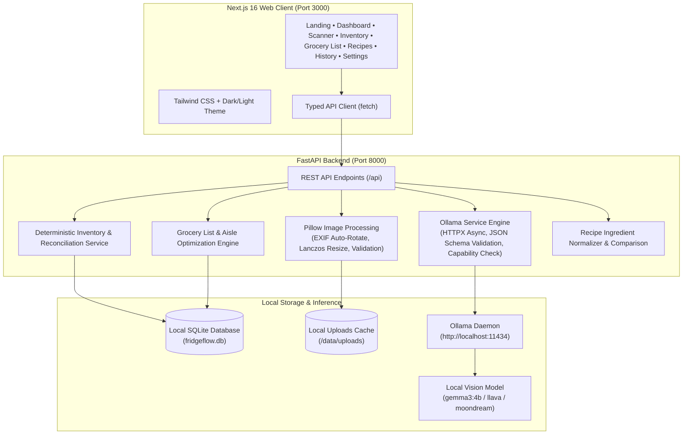

<div align="center">

# 🥦 FridgeFlow AI 🥛
### Local-First AI Fridge Scanner & Smart Grocery Intelligence

**"Your fridge. Decoded."**  
*Snap a photo. Know what you have. Shop only what you need.*

[](https://fastapi.tiangolo.com)
[](https://nextjs.org)
[](https://react.dev)
[](https://www.typescriptlang.org)
[](https://tailwindcss.com)
[](https://ollama.com)
[](https://sqlite.org)
[](https://github.com)
[](https://github.com)

<p align="center">
  <a href="#-key-features">Key Features</a> •
  <a href="#-system-architecture">Architecture</a> •
  <a href="#-quickstart-guide">Quickstart</a> •
  <a href="#-supported-ai-models">Supported AI Models</a> •
  <a href="#-rest-api-reference">API Reference</a> •
  <a href="#-testing">Testing</a> •
  <a href="#-privacy--security">Privacy & Security</a>
</p>

</div>

---

## 📖 Overview

**FridgeFlow AI** is a complete, production-grade, privacy-first web application designed to eliminate open-door kitchen guesswork and unnecessary grocery spending. 

Instead of relying on costly, privacy-invasive cloud APIs (like OpenAI or Google Cloud Vision), FridgeFlow AI executes **100% locally on your own computer** using **Ollama** and vision-capable open models like **Gemma 3** or **LLaVA**.

### The Core Experience
1. **Snap or Upload**: Take a quick picture of your refrigerator shelves, freezer drawers, or pantry.
2. **Local Vision Ingestion**: Your image is sanitized, corrected for EXIF orientation, and parsed by a local AI model in seconds.
3. **Editable Review**: Detected items are classified with confidence ratings. Uncertain or partially occluded items are flagged for your confirmation—preventing phantom inventory.
4. **Intelligent Reconciliation**: Existing ingredients are merged or updated rather than blindly duplicated.
5. **Smart Restock Checklist**: Deterministic threshold intelligence monitors your supply and queues low-stock essentials into an aisle-grouped, touch-friendly shopping list.

---

## 🌟 Key Features

| Feature | Description |
|---|---|
| **🔒 100% Private & Offline** | Zero external API calls. Your personal kitchen photos and grocery habits never leave your local machine. |
| **👁️ Local Computer Vision** | Uses local vision models (Gemma 3 4B, LLaVA, Moondream) via Ollama to identify groceries, produce, drinks, and packaging. |
| **⚖️ Deterministic Stock Logic** | Math-based threshold evaluation (`In Stock`, `Low Stock`, `Out of Stock`, `Unknown`). No hallucinated freshness or safety claims. |
| **🔄 Safe Reconciliation** | Rescanning your fridge proposes updates and quantity merges instead of duplicating items. |
| **🛒 Smart Grocery List** | Automatically organizes items by supermarket aisle (`Produce`, `Dairy & Eggs`, `Meat & Seafood`, `Pantry`, `Frozen`, `Beverages`). |
| **📱 Store Shopping Mode** | Fullscreen, high-contrast, large touch-target checklist mode tailored for navigating grocery store aisles on mobile or tablet. |
| **🍳 Recipe Ingredient Helper** | Input any recipe (or choose quick presets) to compare needed ingredients against current fridge inventory, with 1-click addition of missing items. |
| **📜 Historical Scan Archive** | Browse past scans, review detections, compare two scans side-by-side, and purge local image files on demand. |
| **🎨 Organic Tech Aesthetic** | Meticulously crafted design system featuring Forest Green (`#183D32`), Sage (`#A8C3A0`), Cream (`#F8F7F2`), and Citrus accents with persistent **Light/Dark theme** support. |
| **📤 Data Freedom** | Export your inventory and shopping lists anytime in **CSV**, **Plain Text (.txt)**, or structured **JSON**. |

---

## 🏗️ System Architecture



---

## 💻 System & Hardware Requirements

| Component | Minimum Specification | Recommended Specification |
|---|---|---|
| **CPU** | 4 Cores (x86_64 or Apple Silicon) | 8+ Cores with AVX2 support |
| **RAM** | 8 GB System Memory | 16 GB+ System Memory |
| **GPU (Optional)** | None (runs in CPU mode) | 6 GB+ VRAM (NVIDIA RTX or Apple M-Series) |
| **Disk Space** | 2 GB for dependencies + 3–8 GB per AI model | Fast NVMe SSD |
| **Node.js** | v18.18+ or v20+ | v22 LTS |
| **Python** | 3.11+ | 3.11 – 3.13 |
| **Ollama** | Latest release (v0.5+) | Latest release |

> [!NOTE]  
> If you run without a dedicated GPU, Ollama will execute inference on your CPU. A 4B parameter model like `gemma3:4b` typically takes **8–25 seconds** on modern multi-core CPUs. For near-instant CPU scanning, consider the ultra-lightweight `moondream` model (1.8B).

---

## 🚀 Quickstart Guide

### Step 1: Install & Launch Ollama
1. Download Ollama from [ollama.com/download](https://ollama.com/download).
2. Start the Ollama background daemon:
   ```bash
   ollama serve
   ```
3. Pull the recommended local vision model in a terminal:
   ```bash
   ollama run gemma3:4b
   ```
   *(Keep this terminal open or let Ollama run in the background).*

---

### Step 2: Clone the Repository & Configure Environment

```bash
git clone https://github.com/your-username/fridgeflow-ai.git
cd fridgeflow-ai
```

Copy the sample environment file:

**Windows PowerShell:**
```powershell
Copy-Item .env.example .env
```

**macOS / Linux:**
```bash
cp .env.example .env
```

---

### Step 3: Setup & Launch the Backend (FastAPI)

1. Create and activate a Python virtual environment:

   **Windows PowerShell:**
   ```powershell
   python -m venv backend\venv
   backend\venv\Scripts\Activate.ps1
   ```

   **macOS / Linux:**
   ```bash
   python3 -m venv backend/venv
   source backend/venv/bin/activate
   ```

2. Install backend dependencies:
   ```bash
   pip install -r backend/requirements.txt
   ```

3. Initialize the SQLite database tables:
   ```bash
   python -m backend.app.db.init_db
   ```

4. Start the FastAPI development server:
   ```bash
   python -m uvicorn backend.app.main:app --host 0.0.0.0 --port 8000 --reload
   ```

> [!TIP]  
> Backend interactive OpenAPI documentation is now live at: [http://localhost:8000/docs](http://localhost:8000/docs).

---

### Step 4: Setup & Launch the Frontend (Next.js)

Open a second terminal window in the project root:

```bash
cd frontend
npm install --legacy-peer-deps
npm run dev
```

Open your browser and navigate to:
👉 **[http://localhost:3000](http://localhost:3000)**

---

## 🐳 Running with Docker Compose (Optional)

FridgeFlow AI includes production-ready Docker configuration for both services.

> [!IMPORTANT]  
> A Docker container cannot reach host machine services via `localhost`. The included `docker-compose.yml` configures `host.docker.internal:11434` with `host-gateway` mapping so the backend container can communicate directly with your host's Ollama runtime.

```bash
# Build and run containers
docker-compose up --build
```
Access the web application at [http://localhost:3000](http://localhost:3000).

---

## 🧠 Supported Local AI Models

FridgeFlow AI is model-agnostic. You can switch models dynamically in the **Settings** page (`/settings`) or via `.env`:

| Model Name | Parameter Size | Capabilities | RAM / VRAM | Ollama Command |
|---|---|---|---|---|
| **`gemma3:4b`** *(Default)* | 4 Billion | High-precision vision & structured reasoning | ~4.5 GB | `ollama run gemma3:4b` |
| **`llama3.2-vision:11b`** | 11 Billion | Exceptional label reading & small item detection | ~9.0 GB | `ollama run llama3.2-vision:11b` |
| **`llava:7b`** | 7 Billion | General fridge & shelf scene analysis | ~5.5 GB | `ollama run llava` |
| **`moondream`** | 1.8 Billion | Ultra-fast inference on low-power / CPU-only machines | ~2.2 GB | `ollama run moondream` |

> [!WARNING]  
> Do not select text-only models (such as `llama3:8b` or `mistral`) for image scanning. FridgeFlow AI automatically inspects model metadata via `/api/show` and warns you if a selected model lacks image tensor support.

---

## 📁 Repository Layout

```text
fridgeflow-ai/
├── backend/
│   ├── app/
│   │   ├── api/             # Thin HTTP route handlers (health, scan, inventory, grocery, recipes, settings)
│   │   ├── core/            # App settings (Pydantic BaseSettings), CORS, paths
│   │   ├── db/              # SQLAlchemy session and schema initialization
│   │   ├── models/          # Persistent ORM models (InventoryItem, GroceryListItem, ScanRecord, etc.)
│   │   ├── schemas/         # Pydantic validation schemas & AIScanResult structured output
│   │   ├── services/        # Business logic (Ollama HTTPX client, Pillow pipeline, Reconciliation)
│   │   ├── utils/           # Food plural stemming, category inference, unit normalization
│   │   └── main.py          # FastAPI application entrypoint & lifecycle management
│   ├── tests/               # Comprehensive pytest suite (17 tests)
│   ├── requirements.txt     # Python dependency lockfile
│   └── Dockerfile           # Backend container definition
├── frontend/
│   ├── app/
│   │   ├── page.tsx         # Product landing page with interactive simulation
│   │   ├── dashboard/       # Main overview with metrics, alerts, and quick actions
│   │   ├── scan/            # Dedicated camera/upload interface & AI detection review
│   │   ├── inventory/       # Kitchen stock manager with search, category pills, & inline steppers
│   │   ├── grocery-list/    # Aisle-grouped checklist, smart generator, & Shopping Mode
│   │   ├── recipes/         # Recipe ingredient matcher & inventory shortage detector
│   │   ├── history/         # Historical scan log, drill-down modal, & comparison tool
│   │   ├── settings/        # Ollama connection monitor, model selectors, & data wiper
│   │   └── layout.tsx       # Root layout with ThemeProvider, Navbar, & Footer
│   ├── components/          # Reusable accessible UI components (Navbar, Modal, Card, Badge)
│   ├── lib/                 # Typed API client, TypeScript definitions, & utilities
│   ├── tests/               # Vitest client test suite (5 tests)
│   ├── package.json         # Frontend package definitions
│   └── Dockerfile           # Multi-stage production container definition
├── data/
│   ├── uploads/             # Locally stored, sanitized fridge photos (.gitkeep)
│   └── fridgeflow.db        # SQLite persistent database (git-ignored)
├── .env.example             # Clean environment variables blueprint
├── .gitignore               # Comprehensive Git exclusions (venv, node_modules, .db)
├── docker-compose.yml       # Host-gateway enabled multi-service orchestrator
└── README.md                # Comprehensive documentation
```

---

## 🔌 REST API Reference

The FastAPI backend exposes a clean, fully-typed REST API:

### AI Health & Runtime Status
- `GET /api/health` — Checks service health, uptime, and version.
- `GET /api/ai/status` — Live inspection of Ollama connectivity, installed models, and vision compatibility verification.

### Scanning & Computer Vision
- `POST /api/scan` — Uploads and sanitizes a fridge photo, runs the local vision model, parses structured detections, and stores a `ScanRecord`.
- `GET /api/scans` — Lists historical scan records with detection summaries.
- `GET /api/scans/{scan_id}` — Retrieves full details and candidate detections for a specific scan.
- `POST /api/scans/{scan_id}/confirm` — Commits reviewed candidate items into the inventory via atomic reconciliation.
- `DELETE /api/scans/{scan_id}` — Deletes a scan record and its associated image from local disk.
- `GET /api/scans/image/{filename}` — Safely serves local image previews.

### Kitchen Inventory
- `GET /api/inventory` — Query items with debounced search, category filters, low-stock filter, and sorting.
- `POST /api/inventory` — Manually create an inventory item.
- `PATCH /api/inventory/{item_id}` — Update quantity, thresholds, unit, or expiry dates.
- `DELETE /api/inventory/{item_id}` — Permanently remove an item from stock.
- `POST /api/inventory/reconcile/proposal` — Dry-run reconciliation comparing candidate items against existing stock.
- `POST /api/inventory/reconcile/execute` — Atomically commit reconciliation decisions.

### Smart Grocery List
- `GET /api/grocery-list` — Retrieves the current shopping list with completed/pending counts.
- `POST /api/grocery-list/items` — Adds a grocery item manually.
- `PATCH /api/grocery-list/items/{item_id}` — Toggles completion or edits item details.
- `DELETE /api/grocery-list/items/{item_id}` — Removes an item from the list.
- `DELETE /api/grocery-list/completed` — Clears all checked-off items.
- `POST /api/grocery-list/generate` — Deterministically generates shopping items from low-stock inventory.
- `GET /api/grocery-list/export?format=csv|text` — Exports checklist as CSV or plain text.

### Recipe Matching
- `POST /api/recipes/compare` — Compares required meal ingredients against confirmed inventory and flags shortages.

### Settings & Administration
- `GET /api/settings` — Returns runtime settings and storage paths.
- `PATCH /api/settings` — Updates runtime model configurations and thresholds.
- `POST /api/export/inventory?format=csv|json` — Exports entire inventory to CSV or JSON.
- `POST /api/settings/reset-data?confirm=true` — Safely wipes all local database tables and image uploads.

---

## 🧪 Testing

FridgeFlow AI includes automated test suites covering both frontend logic and backend services.

### Running Backend Tests (pytest)
The backend test suite mocks Ollama network calls to verify schema validation, image security, inventory logic, and reconciliation without needing to download large AI models:

```powershell
# From the project root:
backend\venv\Scripts\python.exe -m pytest backend/tests -v
```

**Results (17 / 17 Passed):**
```text
backend/tests/test_ai_parsing.py::test_parse_valid_ai_json PASSED
backend/tests/test_ai_parsing.py::test_parse_markdown_wrapped_ai_json PASSED
backend/tests/test_ai_parsing.py::test_parse_invalid_ai_output_fails_gracefully PASSED
backend/tests/test_grocery_and_recipe.py::test_grocery_list_and_smart_generation PASSED
backend/tests/test_grocery_and_recipe.py::test_recipe_ingredient_comparison PASSED
backend/tests/test_image_validation.py::test_valid_image_processing PASSED
backend/tests/test_image_validation.py::test_invalid_mime_type PASSED
backend/tests/test_image_validation.py::test_corrupted_image PASSED
backend/tests/test_inventory_service.py::test_inventory_creation_and_stock_status PASSED
backend/tests/test_inventory_service.py::test_low_stock_and_out_of_stock_rules PASSED
backend/tests/test_inventory_service.py::test_reconciliation_proposal_and_execution PASSED
backend/tests/test_normalization.py::test_normalize_ingredient_names PASSED
backend/tests/test_normalization.py::test_normalize_units PASSED
backend/tests/test_normalization.py::test_infer_category PASSED
backend/tests/test_ollama_mock.py::test_health_endpoint PASSED
backend/tests/test_ollama_mock.py::test_ai_status_mocked PASSED
backend/tests/test_ollama_mock.py::test_settings_endpoint PASSED
======================== 17 passed in 0.64s ========================
```

### Running Frontend Tests (Vitest)
Verifies typed API parameter encoding, aisle grouping logic, and checklist math:

```bash
npm --prefix frontend test
```

**Results (5 / 5 Passed):**
```text
✓ tests/workflow.test.ts (2 tests)
✓ tests/api.test.ts (3 tests)
Test Files  2 passed (2)
     Tests  5 passed (5)
```

---

## 🛡️ Privacy & Security

- **Zero Cloud Leakage**: FridgeFlow AI does not send telemetry, analytics, or images to any remote server.
- **Image Sanitization**: Uploaded images are checked for valid image headers using Pillow, EXIF tags are transposed, and temporary files are assigned randomized UUIDs to prevent directory traversal.
- **Retention Controls**: Users can toggle **"Auto-Delete Fridge Photos Immediately After Analysis"** in the Settings tab, ensuring photos are erased as soon as items are cataloged.
- **Local Access Control**: Ollama binds to `localhost` by default, protecting your inference port from external network exposure.

---

## ❓ Frequently Asked Questions (FAQ)

### What if Ollama is not installed or running?
The application functions as a complete manual inventory and grocery list manager even if Ollama is offline. The navigation bar displays an **Ollama Offline** indicator with clear instructions on how to start the service.

### Can I run this on a laptop with no dedicated graphics card?
Yes! Use the `moondream` model (1.8B) or `gemma3:4b` on CPU. You can adjust the timeout in `/settings` if your machine requires additional processing time.

### How does the app avoid duplicate items when scanning repeatedly?
FridgeFlow AI uses **Ingredient Normalization** (e.g., *tomatoes* &rarr; *tomato*, *organic whole milk* &rarr; *whole milk*) combined with **Reconciliation Proposals**. When an item is scanned that already exists in inventory, the system prompts you to update the quantity rather than inserting duplicate records.

---

## 📄 License

This project is open-source and available under the [MIT License](LICENSE).
